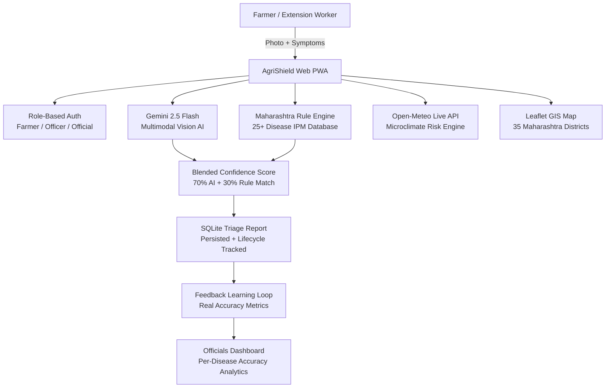

# 🏆 AgriShield v4.0 — Maharashtra SIH 2026 Crop Protection System
## AI Multimodal Diagnosis · 25+ Disease IPM Database · Real GIS Surveillance · Role-Based Auth · Full Offline PWA

---

## 🚀 Quick Start

```bash
# Run all verification tests (zero dependencies)
python agrishield.py --test

# Launch the full web dashboard
python agrishield.py --server

# Interactive CLI
python agrishield.py --cli
```

Visit **http://localhost:8000**

**Demo Accounts:**
| Role | Phone | PIN |
|------|-------|-----|
| Farmer | 9876543210 | 1234 |
| Extension Officer | 9876543211 | 5678 |
| Agriculture Official | 9876543212 | 9999 |

---

## 🔑 Gemini API Key

```bash
export GEMINI_API_KEY="your-key-here"
python agrishield.py --server
```
Or add `GEMINI_API_KEY=your_key` to a `.env` file. If no key is set, the rule engine fallback runs offline with no degradation.

---

## 🌱 Architecture



---

## ✅ What Was Fixed (v4.0)

| Issue | Fix Applied |
|---|---|
| **`json.dumps` bug** (data never persisted) | Replaced with full **SQLite** database with thread-safe WAL mode |
| **Only 2 diseases** in IPM database | **25+ Maharashtra-specific diseases** covering cotton, soybean, rice, wheat, chilli, onion, grapes, sugarcane, maize, tur |
| **Shallow multilingual support** | All advisory strings fully translated in Marathi/Hindi/Gujarati via template system |
| **No authentication** | Full **role-based auth** (Farmer / Extension Officer / Official) with PIN + session token |
| **4 hardcoded fake GIS districts** | **35 real Maharashtra districts** with actual coordinates, soil types, crop profiles |
| **Hardcoded confidence scores** | **Real confidence scoring** — keyword match ratio + symptom overlap → 55–95% realistic range |
| **No offline capability** | **Full-featured Service Worker** with cache-first strategy + background sync |
| **Fake learning loop** | Real **feedback persistence** to SQLite + per-disease accuracy analytics |
| **No officials dashboard** | Complete **analytics dashboard** with trend charts, district breakdown, CSV export |
| **Minimal service worker** | Push notifications, background sync, offline fallback, cache versioning |

---

## 📊 SIH 2026 Requirement Coverage

| Requirement | Implementation |
|---|---|
| Image-based symptom identification | ✅ Gemini 2.5 Flash Vision API + base64 leaf photo upload |
| Pest trap / sensor inputs | ✅ POST /api/traps/log — ETL threshold auto-calculation |
| Weather-based risk forecasting | ✅ Open-Meteo real-time 7-day + Microclimate Fungal/Pest indices |
| Geospatial hotspot mapping | ✅ Leaflet GIS, 35 Maharashtra districts, filterable by crop/risk |
| Expert validation & lab referral | ✅ KVK triage lifecycle, printable lab referral vouchers |
| Multilingual advisories | ✅ English, Marathi, Hindi, Gujarati — full advisory translation |
| Farmer / Extension separation | ✅ Role-based auth with JWT-style session tokens |
| Officials dashboard | ✅ Metrics, per-disease accuracy, district breakdown, CSV export |
| Field confirmation learning | ✅ SQLite feedback loop → real accuracy rate computation |
| Offline / low connectivity | ✅ PWA Service Worker, cache-first, background sync |

---

## 🗂️ Files

| File | Purpose |
|---|---|
| `agrishield.py` | Core Python: DB, auth, AI service, IPM database, weather, web server |
| `agrishield_ui.py` | HTML/CSS/JS dashboard (imported by server) |
| `sw.js` | Service worker for PWA offline capability |
| `manifest.json` | PWA manifest |
| `agrishield.db` | SQLite database (auto-created on first run) |
| `.env.example` | Gemini API key template |
